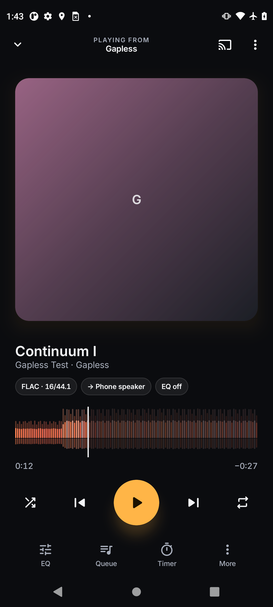
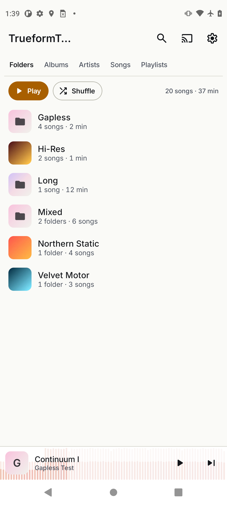
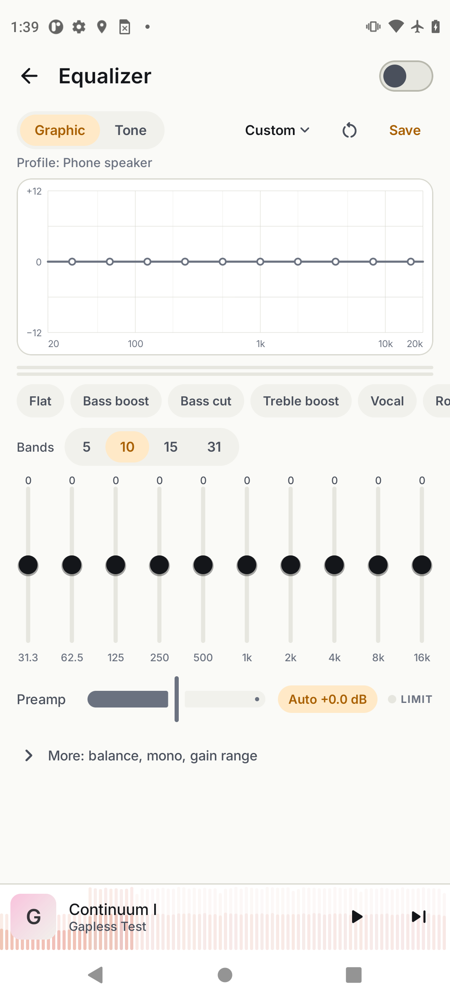

# Trueform Music Player

A hi-fi music player for Android, built around your folders.

**[Download the latest APK](https://github.com/rockenrooster/trueform/releases/latest/download/trueform.apk)** —
Android 10 or later, 64-bit ARM. Installed copies update themselves from GitHub.

<p>
  
  
  
</p>

## What it does

- **Folders first**: browse your music as it sits on the phone, with albums, artists, songs and playlists alongside.
  Pick the folders to scan; new music is picked up as it arrives. When a folder ends, playback continues with the
  next one.
- **Bit-perfect where it can be**: FFmpeg decodes into 32-bit float, the output runs at the file's own sample rate,
  playback is gapless, and with every effect off the audio is untouched.
- **Equalizer that does not clip**: 5, 10, 15 or 31 bands, or simple sub-bass / bass / mid / treble dials. The
  preamp follows the curve automatically, and a transparent look-ahead limiter catches what remains. EQ per output
  (speaker, headphones, each Bluetooth device).
- **Waveform seekbar**: see the loudness of the whole track and jump to any part of it.
- **Chromecast without dropouts**: the Chromecast fetches each track from the phone as a file and keeps its own
  queue, so a busy or sleeping phone does not interrupt it; a dropped Wi-Fi connection pauses nothing on the
  receiver and is picked up again where it was.
- **Bluetooth and cars**: transport keys, artwork and metadata, library browsing and voice search, resume when a
  device connects (optional).
- **Formats**: MP3, FLAC, ALAC, AAC/M4A, Ogg Vorbis, Opus, WMA, WAV, AIFF, WavPack, APE and more, up to 32-bit/384
  kHz. ReplayGain (track or album).
- Lots of settings, all searchable, with defaults that suit most people. Dark, light and black themes.

## Building

Requirements: JDK 17, the Android SDK (platform 37.2, NDK 28.2.13676358, CMake 3.22.1), and a Linux shell (WSL on
Windows) for FFmpeg.

```sh
NDK=/path/to/android-ndk-r28c bash scripts/build-ffmpeg.sh   # without NDK= the script downloads the Linux NDK
./gradlew assembleDebug
```

The debug build installs as `dev.trueform.player.debug`, next to a release. `docs/RELEASE_PIPELINE.md` describes
releases and the updater; `docs/plan/` holds the design; `docs/PROGRESS.md` what was built and measured.

## Licenses

Trueform uses FFmpeg under the LGPL 2.1 or later, AndroidX/Media3 (Apache 2.0), the Google Cast framework, the Inter
typeface (OFL) and Material Symbols (Apache 2.0). Details and the FFmpeg rebuild recipe: [docs/LICENSES.md](docs/LICENSES.md).
